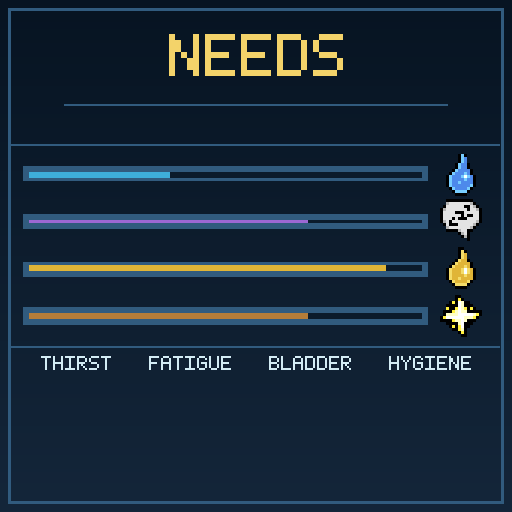

# Needs

Needs is an xStarbound survival-simulation mod that adds Thirst, Fatigue,
Bladder, and Hygiene to the player without replacing the vanilla or Frackin'
Universe HUD.

Current version: **1.13.0**



## Requirements

- Starbound running through xStarbound.
- The bundled `xSBassets` dependency.

This mod uses xStarbound-specific player contexts, full-window canvases,
post-load asset processing, and slash-command handlers. Stock Starbound and
OpenStarbound are not supported. On a client without xStarbound the player
script logs a single warning and disables itself instead of running.

## Features

- Persistent Thirst, Fatigue, Bladder, and Hygiene values.
- Four thin, scale-aware meters anchored beneath the existing hunger bar.
- Native Starbound-style icons and compatibility with FU/FrackinInterface HUD
  geometry.
- Optional hover-only HUD details for each meter: name, value, tier, active
  recovery state, and active penalties. Hidden until hovered, with no permanent
  labels.
- Configurable thresholds, warnings, and nonlethal gameplay consequences.
- Automatic detection of vanilla, FU, and Workshop drinks and foods after all
  assets load.
- Drink profiles (water, juice, milk, soda, caffeine, alcohol, salty, toxic,
  standard, solid-food) and food profiles (meal, heavy, snack, sugary, juicy,
  salty, raw-meat, toxic, caffeinated), with exact mappings for misclassified
  FU items.
- Caffeine relief with remaining-time reporting, alcohol fatigue, dehydration,
  and bladder effects.
- Configurable container returns, such as getting an Empty Bottle back after
  drinking Bottled Water.
- Toilet relief and Hygiene recovery from baths, showers, clean liquids, and
  rain.
- Hygiene loss from activity, combat, dirty liquids, and harsh environments.
- Normal sleeping fully restores Fatigue in about three minutes, and a
  qualifying sleep grants a temporary Rested bonus.
- Day/night Fatigue: staying awake at night adds Fatigue faster.
- Environment-driven Thirst and Fatigue from hot, cold, toxic, and other biomes.
- In-game settings overlay (`/xneeds options`) for user-configurable options:
  HUD meters, hover tooltips, compact bars, always-show values, threshold pulse,
  per-need bar visibility, gameplay toggles (warnings, consequences, feedback,
  day/night fatigue, rested bonus, environment effects), and a difficulty
  selector (Casual, Realistic, Hardcore).
- In-game help via `/xneeds help [topic]` covering needs, tiers, drinks, foods,
  hygiene, sleep, settings, and commands.
- A localizable string table (`xneeds_v0.strings`) for help and system messages.
- Local testing and beverage-diagnostic commands.

## Installation

Place this directory directly in the Starbound `mods` directory:

```text
Starbound/
  mods/
    xneeds_v0/
      _metadata
      xneeds_v0.config
      ...
```

Restart xStarbound after installing or updating the mod. Existing characters
initialize missing Needs data automatically.

## Configuration

All gameplay and presentation tuning is centralized in
[`xneeds_v0.config`](xneeds_v0.config).

Important sections include:

- `beverages` and `foods`: profiles, classification rules, FU exceptions,
  feedback, and container returns. Food affects Thirst, Bladder, and Fatigue
  when eaten.
- `thresholds`, `consequences`, and `warnings`: severity and penalties.
- `hygiene.environment` and `hygiene.combat`: environmental Dirtiness.
- `sleep.bedEffects` and `fatigue.sleepRecoveryPerSecond`: sleep detection and
  rest recovery.
- `fatigue.circadian` and `fatigue.rested`: day/night Fatigue and the temporary
  Rested bonus.
- `thirst.environment` and `fatigue.environment`: biome and environment effect
  gain multipliers, with exact keys plus pattern fallback for modded biome
  variants.
- `hud`: visibility, spacing, colors, native icon paths, and the optional
  hover tooltips.
- `debug`: local testing controls and logging.

Help and system messages are kept in `xneeds_v0.strings` (JSON), which can be
patched or replaced for translation independently of the gameplay config.

### HUD hover details

Hovering any Needs meter displays a compact tooltip beside the meters with the
need name, numeric value, current tier, any active recovery state, and the
active penalties for that need. Tooltips are hover-only, reuse the existing HUD
styling, and add no permanent labels or separate panel. Set
`hud.tooltips.enabled` to `false` to disable them while keeping the meters.

### In-game settings

Run `/xneeds options` to open a settings panel drawn over the HUD. It exposes
HUD options (meters on/off, hover tooltips, compact bars, always-show values,
threshold pulse, per-need bar visibility) and gameplay options (warnings,
consequences, feedback, day/night fatigue, rested bonus, environment effects),
plus a difficulty selector that scales passive gains and decay (Casual,
Realistic, Hardcore). Choices are saved per character and applied immediately;
use the Close button or `/xneeds options` again to close it. The config file
supplies the defaults for a new character.

## Testing commands

Commands are local to the current player and do not require disabling
xStarbound safe scripts.

```text
/xneeds
/xneeds get
/xneeds set fatigue 70
/xneeds set thirst 90
/xneeds set bladder 85
/xneeds set hygiene 25
/xneeds set dirtiness 75
/xneeds set all 85
/xneeds add bladder -20
/xneeds preset critical
/xneeds beverage coffee
/xneeds beverage <itemName>
/xneeds beverages
/xneeds beverages all
/xneeds beverages details
/xneeds beverages <profile>
/xneeds food <itemName>
/xneeds foods
/xneeds foods all
/xneeds foods details
/xneeds foods <profile>
/xneeds options
/xneeds help
/xneeds help <topic>
/xneeds reset
```

The beverage and food commands report the selected profile, classification
source, signed Needs changes, caffeine duration, and any item-specific
overrides.

The beverages and foods audits list every detected item with its resolved
profile and source. With no argument they list only the items that fall back to
the default profile, which are the best candidates for an exact
`beverages.itemProfiles` or `foods.itemProfiles` exception. Pass `all`, a
profile name, or a name fragment to change the listing. `details` adds each
fallback's asset path, source mod, and the description and effect text the
classifier sees, which makes it easy to identify unfamiliar items or patched
asset sources.

## Sleeping

Sleeping in a recognized bed accelerates Fatigue recovery so a full recharge
takes about three minutes. The mod never changes the application time scale or
sends chat commands, avoiding the interaction and save-and-quit problems that
game-clock acceleration caused. Leaving the bed stops the recovery.

## Compatibility

- The mod adds its own player script context only.
- It reads the final loaded hunger-bar geometry instead of replacing
  `teambar.config`.
- Drink hooks are appended after Workshop assets load; existing effects remain
  intact.
- FU files, FrackinInterface files, and vanilla interface files are not
  overwritten.
- Exact exceptions can be added through `beverages.itemProfiles` and
  `foods.itemProfiles` when a modded item cannot be classified reliably.
- Other mods can integrate from their own assets: consumables in the `drink` or
  `food` category are detected automatically, and any item can set
  `needsBeverageProfile` / `needsFoodProfile` (named or inline) plus
  `needsThirstValue`, `needsBladderValue`, `needsFatigueChange`, and
  `needsCaffeineDuration`. See the integrating section in
  [`docs/V1_DEVELOPMENT.md`](docs/V1_DEVELOPMENT.md).

Host requirements:

- **xStarbound + Frackin' Universe, or xStarbound alone:** fully supported.
- **Stock Starbound (with or without FU):** unsupported. The post-load script
  never runs, so drinks and foods are not registered, and the player script
  detects the missing xStarbound APIs and disables itself with one log warning
  instead of erroring.
- **OpenStarbound / StarExtensions:** partially compatible at best, because the
  post-load asset preprocessor is xStarbound-only.

## Safe removal

For the cleanest uninstall while consequences are active:

1. Set `consequences.enabled` to `false`.
2. Start the affected character once.
3. Save and quit normally.
4. Remove the mod.

This allows the player script to clear its namespaced persistent modifiers.
Core Needs values are stored only in the mod's player-script storage and do not
replace vanilla resources.

## Development

Implementation details, extension parameters, and compatibility boundaries are
documented in [`docs/V1_DEVELOPMENT.md`](docs/V1_DEVELOPMENT.md).

Pack the directory itself with xStarbound's `asset_packer`; generated `.pak`
files are intentionally ignored by Git.

## License

Released under the [MIT License](LICENSE).
